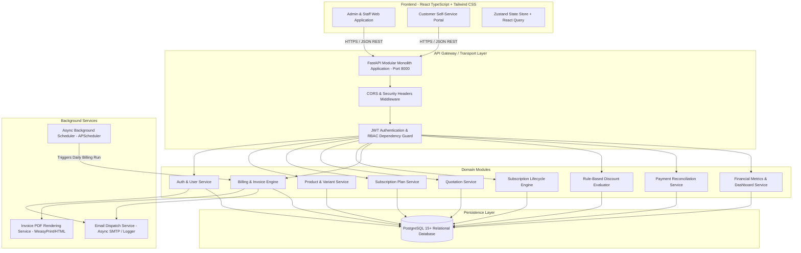
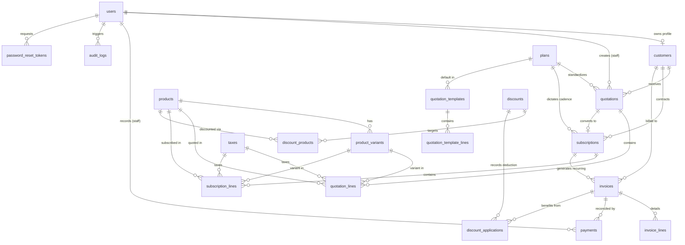
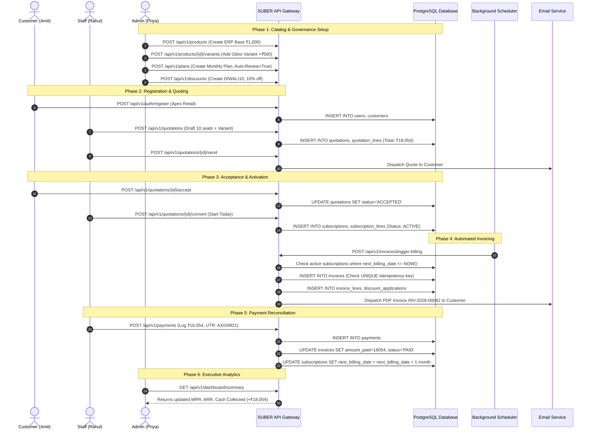
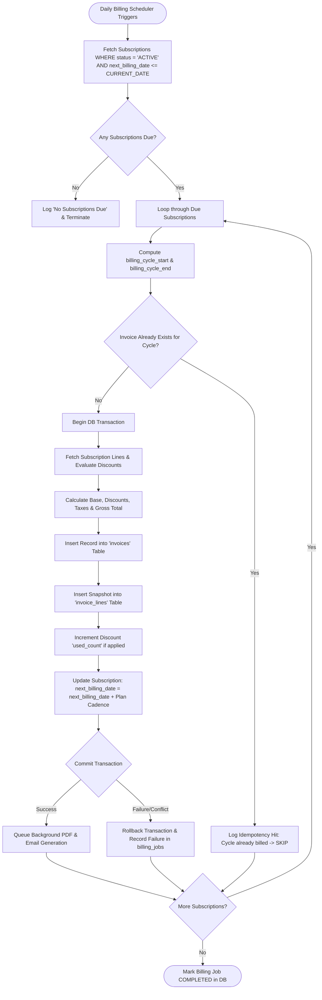

# Product Requirements Document (PRD)
# SUBER – Standalone Business Subscription Management System

**Document Version:** 1.0.0  
**Status:** Approved for Implementation / Architecture Baseline  
**Target Platform:** Web Application (Responsive: Desktop, Tablet, Mobile)  
**Primary Business Scenario:** Brightloop Software  
**Document Author:** Senior Product Manager, Lead Business Analyst & Principal Software Architect  
**Technical Scope:** Modular Monolith (FastAPI + React TypeScript + PostgreSQL) — Standalone Architecture  

---

## Table of Contents
1. [Executive Summary](#1-executive-summary)
2. [Product Vision](#2-product-vision)
3. [Problem Statement](#3-problem-statement)
4. [Business Background & Operating Scenario](#4-business-background--operating-scenario)
5. [Project Objectives & Success Metrics](#5-project-objectives--success-metrics)
6. [Scope and Out-of-Scope](#6-scope-and-out-of-scope)
7. [User Personas](#7-user-personas)
8. [User Roles and Permissions (RBAC Matrix)](#8-user-roles-and-permissions-rbac-matrix)
9. [Functional Requirements (Modules 1–9)](#9-functional-requirements)
10. [User Stories with Acceptance Criteria](#10-user-stories-with-acceptance-criteria)
11. [UI/UX Requirements & Information Architecture](#11-uiux-requirements--information-architecture)
12. [Application & System Architecture](#12-application--system-architecture)
13. [Database Schema & Data Dictionary](#13-database-schema--data-dictionary)
14. [Entity Relationship (ER) Diagram](#14-entity-relationship-er-diagram)
15. [REST API Specification (`/api/v1`)](#15-rest-api-specification-apiv1)
16. [Business Logic, Calculation Formulas & Edge Cases](#16-business-logic-calculation-formulas--edge-cases)
17. [Critical End-to-End Workflows & Sequence Diagrams](#17-critical-end-to-end-workflows--sequence-diagrams)
18. [Non-Functional Requirements (NFRs)](#18-non-functional-requirements-nfrs)
19. [Security, Compliance & Isolation Architecture](#19-security-compliance--isolation-architecture)
20. [Comprehensive Testing Strategy & Test Scenarios](#20-comprehensive-testing-strategy--test-scenarios)
21. [Acceptance Criteria & End-to-End Verification](#21-acceptance-criteria--end-to-end-verification)
22. [Project Implementation Roadmap (Hackathon Delivery)](#22-project-implementation-roadmap-hackathon-delivery)
23. [Team Responsibilities & Work Breakdown Structure](#23-team-responsibilities--work-breakdown-structure)
24. [Risks, Assumptions and Dependencies](#24-risks-assumptions-and-dependencies)
25. [Final Hackathon Demonstration Script & Verification Walkthrough](#25-final-hackathon-demonstration-script--verification-walkthrough)

---

## 1. Executive Summary

**SUBER** is an enterprise-grade, standalone web-based Business Subscription Management System engineered to orchestrate the complete end-to-end operational lifecycle of recurring revenue businesses. SUBER centralizes product catalogs with multi-dimensional variant pricing, dynamic subscription plans, quotation-to-contract workflows, automated recurring invoice generation, rule-based discount engines, multi-method payment reconciliation, and real-time executive financial analytics.

Operating under the primary business scenario of **Brightloop Software**—a B2B software vendor offering core SaaS applications, add-ons, and brand-specific variants across monthly and annual commitments—SUBER eliminates the operational fragmentation caused by spreadsheets, manual invoice drafting, missed renewal windows, and unsynchronized bank reconciliation.

Built as a clean **Modular Monolith** using **Python FastAPI**, **PostgreSQL**, and **React with TypeScript & Tailwind CSS**, SUBER enforces strict idempotency, calendar-aware recurrence calculations, audit logging, and role-based access control (RBAC). It guarantees sub-2-second response times across multi-thousand active subscription portfolios without any external commercial ERP dependency.

---

## 2. Product Vision

### 2.1 Vision Statement
> *"To provide subscription-driven enterprises with an autonomous, mathematically rigorous, and auditable billing and revenue engine that transforms complex multi-variant product pricing and recurring contracts into frictionless customer experiences and real-time financial clarity."*

### 2.2 Core Tenets
1. **Zero-Ambiguity Billing:** No recurring invoice shall ever be duplicated, skipped, or calculated with unverified line amounts.
2. **Deterministic State Lifecycles:** Quotations, subscriptions, and invoices operate as finite state machines with strictly enforced transition guards.
3. **Decoupled Autonomy:** Standalone operability with zero hard technical dependencies on proprietary ERP ecosystems (such as Odoo).
4. **Transparent Financial Duality:** Strict architectural distinction between Billed Revenue (incurred accounts receivable) and Cash Collected (reconciled funds).
5. **Auditable Traceability:** Every administrative modification, discount application, payment allocation, and state transition maintains an immutable audit log.

---

## 3. Problem Statement

Companies managing recurring subscriptions through disparate tooling suffer from critical operational failures:

| Current Pain Point | Operational Impact at Brightloop Software | SUBER Architectural Solution |
| :--- | :--- | :--- |
| **Spreadsheet Tracking** | Renewal dates forgotten; subscriptions expire unnoticed without customer notification or renewal quotes. | Automated lifecycle state machine with configurable auto-renewal and proactive expiration queues. |
| **Manual Invoice Drafting** | Finance staff spend days calculating variant surcharges, volume breaks, and taxes, creating calculation errors. | Automated billing scheduler calculating variant deltas, discount hierarchies, and tax formulas deterministically. |
| **Duplicate / Skipped Billing** | Invoices sent twice during manual runs or omitted when billing days fall on weekends or month-ends. | Idempotent billing jobs enforced by database constraints `(subscription_id, billing_cycle_start, billing_cycle_end)`. |
| **Disconnected Reconciliation** | Scrolling through bank statements and manually guessing which customer paid which partial invoice. | Multi-payment allocation ledger linking distinct transaction references to exact invoice balances. |
| **Blinded Executive Metrics** | MRR, ARR, and churn numbers take weeks to assemble at quarter-end; cash flow vs. revenue is conflated. | Real-time computation engine calculating active MRR, ARR, collected cash, and aging overdue receivables. |

---

## 4. Business Background & Operating Scenario

### 4.1 Fictional Enterprise: Brightloop Software
Brightloop Software is a mid-market B2B software and digital services provider headquartered in Bangalore with operations across India and APAC. 

### 4.2 Business Model & Offerings
1. **Core Subscription Products:** Cloud ERP core licenses, CRM suites, and Helpdesk software billed on recurring cycles (monthly, yearly, weekly).
2. **Product Variants:** Products configured with variant attributes (e.g., Brand/Edition). 
   - *Example:* "Brightloop Enterprise Suite" Base Price = **₹1,000 / seat / month**.
   - *Variant Surcharge:* "Odoo Edition Compatibility Layer" adds **+₹560 / seat / month**, yielding a combined unit price of **₹1,560 / seat / month**.
3. **Add-on Services:** Dedicated IP, extra storage packs, priority 24/7 SLA, and API rate-limit boosts.
4. **Customer Diversity:**
   - Small businesses with 1–5 seats on monthly credit-card / UPI subscriptions.
   - Enterprise clients with 50–500 seats on annual contracts, custom discount schedules, and Net-30 payment terms via bank wire transfer.

### 4.3 Operational Personas at Brightloop
- **Admin (Priya - Head of Operations & Finance):** Configures fiscal tax rates (GST 18%), defines discount promotions, manages product variant catalogs, and provisions staff access.
- **Staff (Rahul - Senior Account Executive / Operations):** Prepares client quotes from standardized templates, confirms subscriptions, monitors invoices, and records incoming bank transfers.
- **Customer (Amit - CTO at Apex Retail):** Self-registers, reviews quotation offers, views active subscriptions and upcoming renewal dates, downloads PDF invoices, and tracks payment history.

---

## 5. Project Objectives & Success Metrics

| Strategic Objective | Measurable Key Performance Indicator (KPI) | Target Benchmark |
| :--- | :--- | :--- |
| **1. Centralized Lifecycle** | Single source of truth for all customers, plans, quotes, and subscriptions. | 100% elimination of manual Excel trackers. |
| **2. Automated Recurring Billing** | Scheduled execution generating recurring invoices on exact anniversary dates. | Zero manual intervention for standard renewals; 100% on-time generation. |
| **3. Invoicing Accuracy** | Mathematical accuracy across multi-tier variants, volume lines, discounts, and taxes. | 0.00% rounding discrepancy; 100% checksum verification. |
| **4. Zero Duplicate Billing** | Prevent double invoicing under concurrent execution or retry attempts. | 0 duplicate invoices allowed via database unique constraints. |
| **5. Payment Reconciliation** | Partial and multi-payment support with real-time balance tracking. | Instant calculation of outstanding balance and overdue state flags. |
| **6. Real-Time Financial Clarity** | Instant dashboard metrics for MRR, ARR, Cash Collected, and Overdue balances. | Real-time dashboard refresh with zero offline ETL lag. |
| **7. Enterprise RBAC Security** | Strict data isolation preventing customer data leaks and staff privilege escalations. | Zero cross-tenant data leaks; 100% blocked unauthorized role actions. |
| **8. High Performance at Scale** | Response latency under simulated load of 10,000 subscriptions and 50,000 invoices. | P95 API response time **< 1.8 seconds**; UI page load **< 2.0 seconds**. |

---

## 6. Scope and Out-of-Scope

### 6.1 In-Scope (Mandatory Core Requirements)
1. **Identity & Access Management:** Registration, secure authentication, password policies, forgot/reset email tokens, RBAC for Admin, Staff, Customer.
2. **Catalog Management:** Products, multi-attribute variants with price deltas, consumable/service/software product types.
3. **Subscription Plans:** Recurrence intervals (Daily, Weekly, Monthly, Yearly), minimum order quantities, validity windows, closure rules.
4. **Quotation Workflow:** Standardized templates, multi-line quotes, tax & discount auto-calculation, validity period, one-click conversion to subscription.
5. **Subscription Engine:** State machine (Draft → Quotation → Confirmed → Active → Closed), pause/resume, early closure, renewal configurations.
6. **Billing & Invoicing Engine:** Automated recurring invoice generator, customer/line snapshotting, unique numbering (`INV-YYYY-XXXXX`), PDF rendering.
7. **Discounts Engine:** Fixed amount and percentage discounts, min spend/quantity rules, product-specific vs. whole-order scopes, usage limits, expiration.
8. **Payment Ledger:** Multi-payment recording against invoices, payment method tagging, real-time balance adjustments, status progression (Unpaid → Partially Paid → Paid).
9. **Financial Dashboard:** Visual metrics for Active Subscriptions, MRR, ARR, Billed vs. Cash Collected, Overdue Aging, Top Products.
10. **Customer Portal:** Dedicated self-service interface for customers to view subscriptions, renewal dates, invoices, and payment receipts.

### 6.2 Out-of-Scope (Strictly Excluded)
- Direct physical inventory stock picking and warehouse bin routing.
- Native payment gateway API token vaults (e.g., Stripe Elements live card tokenizer; payments in SUBER are recorded via internal transaction ledger reference).
- Personal expense tracking and payroll management.
- Hard dependency or required integration with Odoo ERP core runtime.
- Multi-currency forex live re-evaluation (all baseline monetary figures standardized to INR `₹` with clean extensible architecture).

---

## 7. User Personas

### Persona 1: Admin – Priya Sharma (Head of Operations & Finance)
- **Goals:** Maintain product pricing integrity, protect margins with discount governance, monitor MRR/ARR, and ensure zero missed billing.
- **Frustrations:** Staff giving ad-hoc discounts without authorization; reconciliation nightmares at month-end.
- **Platform Usage:** Configures taxes, creates discount codes, provisions staff accounts, reviews executive financial dashboards.

### Persona 2: Staff – Rahul Verma (Sales & Operations Lead)
- **Goals:** Rapidly generate enterprise quotations, convert deals into active contracts, and log client wire payments accurately.
- **Frustrations:** Manually recalculating taxes and line totals on custom contracts; missing client renewal windows.
- **Platform Usage:** Uses quotation templates, converts quotes to subscriptions, logs payments against invoice IDs.

### Persona 3: Customer – Amit Desai (VP of Engineering at Apex Retail)
- **Goals:** Review contracted seat tiers, view upcoming renewal dates, verify invoices, and download stamped PDF receipts for accounting.
- **Frustrations:** Having to email vendor support just to get an invoice copy or check contract expiry dates.
- **Platform Usage:** Logs into the self-service portal, views active plans, inspects payment history, downloads official PDF invoices.

---

## 8. User Roles and Permissions (RBAC Matrix)

SUBER enforces a 3-tier Role-Based Access Control model. Role permissions are verified on both the frontend UI (conditional rendering) and the backend API (dependency injection guards).

### 8.1 Role Definitions
1. **Admin (`ADMIN`):** Unrestricted superuser. Sole authority to provision staff accounts, configure discount rules, modify taxes, and alter global system settings.
2. **Staff (`STAFF`):** Operational user. Can manage customers, draft quotations, manage subscriptions, generate invoices, record payments, and inspect operational metrics. Cannot manage staff accounts or create discount master rules.
3. **Customer (`CUSTOMER`):** External authenticated user. Restricted strictly to reading and managing their own customer profile, subscriptions, quotes, invoices, and payment history. Data isolation enforced at database query level.

### 8.2 Granular RBAC Matrix

| Functional Module | Resource / Operation | Admin (`ADMIN`) | Staff (`STAFF`) | Customer (`CUSTOMER`) |
| :--- | :--- | :---: | :---: | :---: |
| **Authentication** | Self-Registration | ❌ | ❌ | ✅ |
| | Login / Logout / Reset Password | ✅ | ✅ | ✅ |
| | Create Staff Accounts | ✅ | ❌ | ❌ |
| | Deactivate Users / Change Roles | ✅ | ❌ | ❌ |
| **Customer Mgmt** | Create / Update Customers | ✅ | ✅ | ❌ |
| | View Customer List & Full Profiles | ✅ | ✅ | ❌ |
| | View / Update Own Profile | ✅ | ✅ | ✅ (Self Only) |
| **Product & Plans** | Create / Edit / Deactivate Products | ✅ | ❌ | ❌ |
| | Create / Edit Product Variants | ✅ | ❌ | ❌ |
| | Create / Edit Subscription Plans | ✅ | ❌ | ❌ |
| | View Active Products, Variants, Plans | ✅ | ✅ | ✅ (Catalog view) |
| **Quotations** | Create / Edit Quotation Templates | ✅ | ❌ | ❌ |
| | Generate Quotation for Customer | ✅ | ✅ | ❌ |
| | View All Quotations | ✅ | ✅ | ❌ |
| | View / Accept / Reject Own Quote | ✅ | ✅ | ✅ (Self Only) |
| | Convert Quotation to Subscription | ✅ | ✅ | ❌ |
| **Subscriptions** | Create / Confirm Subscriptions | ✅ | ✅ | ❌ |
| | View All Subscriptions | ✅ | ✅ | ❌ |
| | View Own Subscriptions & Renewals | ✅ | ✅ | ✅ (Self Only) |
| | Pause / Resume / Close Subscription | ✅ | ✅ | ❌ |
| **Invoicing** | Trigger Automated / Manual Billing Run | ✅ | ✅ | ❌ |
| | View All Invoices | ✅ | ✅ | ❌ |
| | View / Download Own Invoices (PDF) | ✅ | ✅ | ✅ (Self Only) |
| | Cancel / Void Invoice | ✅ | ❌ | ❌ |
| **Discounts** | Create / Edit / Deactivate Discounts | ✅ | ❌ | ❌ |
| | View Discount Master Rules | ✅ | ✅ (Read Only) | ❌ |
| | Apply Eligible Discount Code | ✅ | ✅ | ✅ (At Checkout) |
| **Payments** | Record Payment against Invoice | ✅ | ✅ | ❌ |
| | View All Payment Records | ✅ | ✅ | ❌ |
| | View Own Payment Receipts | ✅ | ✅ | ✅ (Self Only) |
| **Taxes & Config** | Configure Tax Rates (e.g., GST 18%) | ✅ | ❌ | ❌ |
| **Reports & BI** | Executive Dashboard (MRR, ARR, Cash) | ✅ | ✅ (Operational) | ❌ |
| | Export Financial Audit Reports | ✅ | ❌ | ❌ |

---

## 9. Functional Requirements

### Module 1: Authentication and User Management
- **FR-1.1 Customer Self-Registration:** Allows external customers to create an account with First Name, Last Name, Company Name, Mobile Number, and unique Work Email.
- **FR-1.2 Unique Email Enforcement:** Enforced at database schema level (`UNIQUE` constraint on `users.email`).
- **FR-1.3 Password Complexity Validation:** Minimum 9 characters (strictly *more than 8 characters*), containing at least one uppercase letter `[A-Z]`, at least one lowercase letter `[a-z]`, at least one numeric digit `[0-9]`, and at least one special character `[!@#$%^&*(),.?":{}|<>]`.
- **FR-1.4 Cryptographic Password Hashing:** Passwords hashed using Argon2id (or bcrypt with salt rounds >= 12). Plaintext passwords never logged or persisted.
- **FR-1.5 Forgot Password & Tokenized Reset:** Users request a password reset; system generates a cryptographically secure, time-limited reset token (valid for 30 minutes, single-use) and logs an email notification.
- **FR-1.6 Admin Staff Provisioning:** Only authenticated Admins can provision internal Staff accounts and assign roles. Staff accounts cannot be self-registered.
- **FR-1.7 JWT Session Handling:** Issues short-lived access tokens (15-minute expiry) and rotating refresh tokens (7-day expiry) stored securely in HttpOnly cookies or Authorization headers.

### Module 2: Product & Variant Management
- **FR-2.1 Product Catalog CRUD:** Admins can create, view, edit, and soft-delete/deactivate products.
- **FR-2.2 Product Attributes:** Mandatory fields include Product Code/SKU, Product Name, Product Type (`SERVICE`, `SOFTWARE_LICENSE`, `CONSUMABLE`), Standard Sales Price (Base INR), Standard Cost Price (INR), Description/Notes, and Active Status.
- **FR-2.3 Product Variant Engine:** Products support multi-attribute variants (e.g., Brand, Cloud Region, Edition).
- **FR-2.4 Variant Additional Pricing:** Each variant record defines an additional surcharge (`additional_price`) added to the parent base sales price.
  - *Reference Scenario:* Base Product "Brightloop Enterprise Suite" = ₹1,000. Variant "Odoo Brand Compatibility" = +₹560. Final Unit Price = ₹1,560.
- **FR-2.5 Variant Validation:** Prevents deletion of products or variants actively bound to existing quotations or active subscriptions.

### Module 3: Subscription Plan Management
- **FR-3.1 Plan Definition:** Admins configure recurring plans with Plan Name, Plan Code, and Recurrence Frequency.
- **FR-3.2 Supported Billing Frequencies:** 
  - `DAILY` (Every 1 calendar day)
  - `WEEKLY` (Every 7 calendar days)
  - `MONTHLY` (Anniversary or month-end calendar date)
  - `YEARLY` (Anniversary 365/366 calendar days)
- **FR-3.3 Minimum Order Quantity (MOQ):** Configurable minimum seat/license quantity required to subscribe to the plan (e.g., minimum 5 seats).
- **FR-3.4 Plan Availability Dates:** `valid_from` and `valid_until` timestamps. Subscriptions cannot be initiated for expired or unreleased plans.
- **FR-3.5 Automated Closure Toggle:** If enabled (`auto_close_at_expiry = True`), subscription transitions to `CLOSED` upon reaching expiry without manual intervention.
- **FR-3.6 Early Closure Permission:** Toggle determining if Staff/Customers can terminate the contract before the contractual term end.
- **FR-3.7 Pause/Resume Configuration:** Toggle enabling subscriptions under this plan to be suspended temporarily (freezing recurring invoice generation) and resumed later.
- **FR-3.8 Auto-Renewal Policy:** Configurable default renewal behavior (Auto-renew into same plan vs. Require explicit customer confirmation).

### Module 4: Quotation Management
- **FR-4.1 Quotation Templates:** Admins create reusable templates containing predefined product line items, default plan associations, and standard payment terms (e.g., "Standard Enterprise SaaS Onboarding Template").
- **FR-4.2 Quotation Generation:** Staff generates customer-specific quotations selecting customer record, validity duration (in days), currency, and customized line items.
- **FR-4.3 Line Item Calculation:** Dynamic recalculation of base unit price, variant surcharge, quantity, discount deduction, tax surcharge, and line total.
- **FR-4.4 Quotation Status Tracking:** Supported statuses: `DRAFT` → `SENT` → `ACCEPTED` → `REJECTED` / `EXPIRED`.
- **FR-4.5 Expiration Enforcement:** System automatically marks quotations as `EXPIRED` once `quotation_date + validity_days < current_date`.
- **FR-4.6 One-Click Subscription Conversion:** Once a quotation is marked `ACCEPTED`, Staff can trigger instant conversion, generating an associated Subscription record preserving all negotiated rates, variant specs, and quantities.

### Module 5: Subscription Lifecycle Management
- **FR-5.1 Subscription Profile:** Unique subscription identifier (`SUB-YYYY-XXXXX`), Customer FK, Plan FK, Start Date, Expiry Date, Billing Anniversary Day, Payment Terms (`IMMEDIATE`, `NET_15`, `NET_30`), Status, and Line Items.
- **FR-5.2 Comprehensive Lifecycle States:**
  ```mermaid
  stateDiagram-v2
      [*] --> Draft: Staff creates quote/order
      Draft --> Quotation: Submit for customer review
      Quotation --> Confirmed: Customer accepts quote
      Confirmed --> Active: Initial invoice confirmed / activation date reached
      Active --> Paused: Temporary suspension requested
      Paused --> Active: Resume requested
      Active --> Closed: Expiry date reached or early closure executed
      Confirmed --> Closed: Cancelled before activation
      Closed --> [*]
  ```
- **FR-5.3 Transition Guards:**
  - Cannot transition directly from `Draft` to `Active` without confirmation.
  - Cannot generate billing invoices for `Paused`, `Draft`, or `Closed` subscriptions.
  - Cannot close a subscription with unconfirmed draft invoices without explicit administrative override.
- **FR-5.4 Controlled Pause and Resume:** Pausing records `paused_at` timestamp and calculates paused duration to adjust the subsequent renewal date proportionally.
- **FR-5.5 Renewal Engine:** Active subscriptions nearing expiration can be renewed, incrementing the term (e.g., +1 month or +1 year) and generating a consecutive subscription term.

### Module 6: Automated Invoice Management
- **FR-6.1 Automated Invoicing Run:** Daily background billing job identifies all active subscriptions where `next_billing_date <= current_date`.
- **FR-6.2 Snapshot Integrity:** Invoices capture a point-in-time immutable snapshot of customer billing address, product titles, variant attributes, negotiated unit prices, discount lines, and tax rates. Subsequent changes to product catalog prices do not alter historical invoices.
- **FR-6.3 Numbering Convention:** Unique, sequential, auditable invoice codes (e.g., `INV-2026-00001`).
- **FR-6.4 Invoice Lifecycle:** `DRAFT` → `CONFIRMED` → `PAID` (or `CANCELLED`).
- **FR-6.5 Duplicate Billing Prevention:** Strict idempotency key generation: `hash(subscription_id, billing_cycle_start, billing_cycle_end)`. Duplicate job runs silently pass if an invoice already exists for the cycle.
- **FR-6.6 PDF Invoice Generation:** Clean, professional, printable PDF invoice containing company logo, Brightloop GSTIN, customer details, line-item breakdowns, discount lines, tax splits, and bank payment instructions.
- **FR-6.7 Communication Dispatch:** Dispatches an invoice confirmation notification to the customer's registered email with direct portal download links.

### Module 7: Discount Management
- **FR-7.1 Admin-Only Governance:** Only users with `ADMIN` role can create, update, or deactivate discount master rules.
- **FR-7.2 Discount Typologies:**
  - `PERCENTAGE`: Deducts $X\%$ from the eligible line or subtotal (e.g., 10% off).
  - `FIXED_AMOUNT`: Deducts a flat currency sum (e.g., ₹500 off).
- **FR-7.3 Application Scopes:**
  - `PRODUCT_SPECIFIC`: Applies only to designated product line items (e.g., 20% off Cloud Backup add-on).
  - `SUBSCRIPTION_LEVEL`: Applies across the total pre-tax subtotal of the invoice.
- **FR-7.4 Eligibility Conditions:**
  - Minimum purchase amount (e.g., Subtotal must be >= ₹5,000).
  - Minimum seat quantity (e.g., Total seats must be >= 10).
- **FR-7.5 Temporal & Volume Caps:**
  - Date validity window: `valid_from` to `valid_until`.
  - Max usage count: `max_uses` (e.g., First 50 customers only).
  - Current usage counter: `used_count` incremented atomically upon invoice confirmation.
- **FR-7.6 Expiration & Depletion:** Inactive, expired, or fully depleted discount rules are rejected during quotation or invoice generation.

### Module 8: Payment Recording & Reconciliation
- **FR-8.1 Manual & Recorded Transactions:** Records payment transactions against specific confirmed invoices.
- **FR-8.2 Payment Metadata:** Payment Date, Amount Paid (INR), Payment Method (`BANK_TRANSFER`, `UPI`, `CREDIT_CARD`, `DEBIT_CARD`, `CASH`, `CHEQUE`), Transaction Reference / UTR Number, Internal Notes, and Recorded By Staff FK.
- **FR-8.3 Multi-Payment & Partial Payment Support:** Allows multiple discrete payments against a single invoice until the total balance is cleared.
- **FR-8.4 Dynamic Payment Status Tracking:**
  - `amount_paid == 0`: Invoice is `UNPAID`.
  - `0 < amount_paid < total_amount`: Invoice is `PARTIALLY_PAID`.
  - `amount_paid == total_amount`: Invoice transitions to `PAID`.
  - `amount_paid > total_amount`: System validation prevents recording payment exceeding remaining outstanding balance.
- **FR-8.5 Overdue Tracking:** Any invoice where `status != 'PAID'` and `due_date < current_date` is tagged as `OVERDUE`.

### Module 9: Business Dashboard & Financial Analytics
- **FR-9.1 Active Subscription Count:** Real-time count of subscriptions currently in `ACTIVE` state.
- **FR-9.2 Monthly Recurring Revenue (MRR):** Total normalized recurring revenue across all active subscriptions normalized to a 30-day monthly value.
- **FR-9.3 Annual Recurring Revenue (ARR):** Calculated deterministically as $\text{MRR} \times 12$.
- **FR-9.4 Billed Revenue vs. Cash Collected:** Explicit visual separation:
  - **Billed Revenue:** Sum of `total_amount` across all confirmed invoices in the period.
  - **Cash Collected:** Sum of actual `amount` across all reconciled `payments` in the period.
- **FR-9.5 Outstanding Accounts Receivable:** Total unpaid balance across all confirmed invoices.
- **FR-9.6 Aging Overdue Invoices:** Breakdown of overdue amounts categorized by age (< 30 days, 30–60 days, 60+ days).
- **FR-9.7 Upcoming Renewals Queue:** Table listing all subscriptions scheduled to expire within the next 7, 15, and 30 days.
- **FR-9.8 Granular Filtering:** Global dashboard filters for Date Range (Today, This Month, This Quarter, Custom Range), Subscription Status, Product, and Customer.

---

## 10. User Stories with Acceptance Criteria

### US-01: Admin Configures Multi-Variant Product Catalog
- **As an** Admin (Priya),
- **I want to** create the "Brightloop ERP Core" product with an "Odoo Edition" brand variant adding ₹560 to the base price of ₹1,000,
- **So that** our sales team can quote custom compatibility editions accurately.
- **Acceptance Criteria:**
  - Base product created with sales price ₹1,000 and cost price ₹600.
  - Variant attribute "Brand" created with value "Odoo Brand" and price surcharge ₹560.
  - Catalog shows calculated combined price ₹1,560.
  - System rejects negative base price or variant price below 0.

### US-02: Customer Registers and Enforces Password Security
- **As a** new Customer (Amit),
- **I want to** register on the portal using my email and a strong password,
- **So that** I can securely access my company's subscriptions and invoices.
- **Acceptance Criteria:**
  - Submitting `test@apex.com` with password `Pass1!` fails validation (<= 8 chars).
  - Submitting password `password123` fails validation (missing uppercase and special char).
  - Submitting `ApexStrong#2026` succeeds, stores Argon2id hash, and returns JWT.
  - Duplicate registration with `test@apex.com` returns HTTP 409 Conflict.

### US-03: Sales Rep Generates Quote from Template
- **As a** Staff member (Rahul),
- **I want to** select an Enterprise Onboarding template and generate a 15-day quote for Apex Retail,
- **So that** I don't have to manually build repetitive subscription lines from scratch.
- **Acceptance Criteria:**
  - Template lines populate 10 seats of Brightloop ERP + Odoo Brand Variant (₹1,560/ea).
  - System calculates Subtotal: ₹15,600, GST (18%): ₹2,808, Total: ₹18,408.
  - Quote valid until `Current Date + 15 days`.
  - Quote visible to Customer Amit upon login.

### US-04: Automated Billing Prevents Duplicate Invoices
- **As the** Billing Engine,
- **I want to** generate monthly renewal invoices without creating duplicates if the scheduler triggers twice,
- **So that** customers are never charged double for the same billing window.
- **Acceptance Criteria:**
  - Scheduler runs for Subscription #SUB-2026-00012 on billing date `2026-11-01`.
  - First execution generates Invoice `INV-2026-00089` for period `2026-11-01` to `2026-11-30`.
  - Immediate subsequent execution detects existing record for this subscription and period; logs an idempotency hit and skips generation with zero duplicate records created.

### US-05: Staff Records Partial Bank Wire Payment
- **As a** Staff member (Rahul),
- **I want to** record a partial payment of ₹10,000 against an invoice of ₹18,408,
- **So that** the system accurately reflects the remaining balance and overdue risk.
- **Acceptance Criteria:**
  - Invoice status updates from `UNPAID` to `PARTIALLY_PAID`.
  - Paid amount displays ₹10,000.00; Outstanding balance displays ₹8,408.00.
  - Attempting to record a second payment of ₹9,000 is rejected with a validation error (exceeds balance of ₹8,408).
  - Recording ₹8,408 updates status to `PAID`.

---

## 11. UI/UX Requirements & Information Architecture

### 11.1 Design System & Aesthetic Foundations
- **Color Palette:**
  - Primary Brand: Deep Indigo (`#4F46E5` / Tailwind `indigo-600`)
  - Accent / Highlights: Vibrant Cyan (`#06B6D4` / `cyan-500`)
  - Surface Light: Neutral Slate (`#F8FAFC` background, `#FFFFFF` cards)
  - Surface Dark: Sleek Charcoal (`#0F172A` background, `#1E293B` cards)
  - Semantic Statuses:
    - Success / Active / Paid: Emerald (`#10B981`)
    - Warning / Paused / Partial: Amber (`#F59E0B`)
    - Danger / Overdue / Closed: Rose / Red (`#EF4444`)
    - Information / Draft: Slate / Sky (`#0EA5E9`)
- **Typography:** Modern variable font `Inter` or `Plus Jakarta Sans` for clean data legibility. Fixed-width `JetBrains Mono` for currency figures, invoice numbers, and SKU codes.
- **Responsiveness:** Fluid grid layouts adapting seamlessly across Desktop (1440px+), Tablet (768px–1024px), and Mobile (< 768px). Mobile layouts convert data tables into swipeable card views.
- **Dark Mode Support:** Full first-class dark mode toggle persisting user preference in `localStorage` with smooth CSS transitions.

### 11.2 Core Navigation & Page Inventory

```mermaid
graph TD
    A[SUBER Application] --> B[Public Routes]
    A --> C[Staff / Admin Portal]
    A --> D[Customer Portal]

    B --> B1[Login Page]
    B --> B2[Customer Registration]
    B --> B3[Forgot / Reset Password]

    C --> C1[Dashboard / Analytics]
    C --> C2[Products & Variants Catalog]
    C --> C3[Subscription Plans]
    C --> C4[Quotations Management]
    C --> C5[Subscriptions Lifecycle]
    C --> C6[Invoices & Billing Runs]
    C --> C7[Payments Ledger]
    C --> C8[Discount Engine - Admin Only]
    C --> C9[User & Staff Management - Admin Only]
    C --> C10[System Audit Logs - Admin Only]

    D --> D1[My Overview / Active Subscriptions]
    D --> D2[My Quotations & Approvals]
    D --> D3[My Invoices & PDF Downloads]
    D --> D4[Payment Receipts & History]
    D --> D5[Company Profile Settings]
```



### 11.3 UI Components Standard Library
1. **Interactive Data Tables:** Column sorting, quick-search input, filter pills (status, date), bulk action bars, and sticky header pagination (10, 25, 50, 100 rows).
2. **Status Badges:** Color-coded pill badges with micro-dot indicators (e.g., green dot for `Active`, yellow pulsing dot for `Pending Approval`).
3. **Modal Dialogs:** Accessible confirmation modals with explicit consequence text for irreversible actions (e.g., closing a subscription early or voiding an invoice).
4. **Toast Notifications:** Ephemeral status toasts (Top-Right, 4000ms duration) with success, warning, error, and progress states.
5. **Empty & Loading States:** Curated illustrations and skeleton loaders preventing layout shifts during asynchronous data fetches.

---

## 12. Application & System Architecture

### 12.1 High-Level Architecture (Modular Monolith)



### 12.2 Rationale for Architecture Selection
- **Modular Monolith over Microservices:** Avoids network latency, distributed transaction complexity (SAGA/2PC), and DevOps overhead. Ideal for a fast, reliable, hackathon-developed enterprise system while keeping domain boundaries clean and modular.
- **FastAPI:** High performance asynchronous Python with native OpenAPI/Swagger auto-generation, strict type validation via Pydantic v2, and dependency injection for RBAC.
- **PostgreSQL:** ACID compliance, native relational constraints, composite unique indexing for idempotency, and high precision `NUMERIC` types essential for financial integrity.

---

## 13. Database Schema & Data Dictionary

All financial currency columns are strictly typed as `NUMERIC(12, 2)` to eliminate floating-point arithmetic errors. All timestamps are stored with timezone (`TIMESTAMP WITH TIME ZONE`).

### Table 1: `users`
Stores all platform identities (Admins, Staff, and Customers).

| Column Name | Data Type | Constraints | Description |
| :--- | :--- | :--- | :--- |
| `id` | `UUID` | `PRIMARY KEY, DEFAULT gen_random_uuid()` | Unique internal user identifier |
| `email` | `VARCHAR(255)` | `NOT NULL, UNIQUE` | Normalized login email address |
| `password_hash` | `VARCHAR(255)` | `NOT NULL` | Argon2id cryptographic password hash |
| `first_name` | `VARCHAR(100)` | `NOT NULL` | User given name |
| `last_name` | `VARCHAR(100)` | `NOT NULL` | User family name |
| `role` | `VARCHAR(20)` | `NOT NULL, CHECK (role IN ('ADMIN', 'STAFF', 'CUSTOMER'))` | User permission role |
| `is_active` | `BOOLEAN` | `NOT NULL, DEFAULT TRUE` | Active account toggle |
| `created_at` | `TIMESTAMPTZ` | `NOT NULL, DEFAULT NOW()` | Account creation timestamp |
| `updated_at` | `TIMESTAMPTZ` | `NOT NULL, DEFAULT NOW()` | Last update timestamp |

*Indexes:* `idx_users_email` (UNIQUE), `idx_users_role`.

---

### Table 2: `customers`
Stores customer business profiles linked to user accounts.

| Column Name | Data Type | Constraints | Description |
| :--- | :--- | :--- | :--- |
| `id` | `UUID` | `PRIMARY KEY, DEFAULT gen_random_uuid()` | Customer business record ID |
| `user_id` | `UUID` | `NOT NULL, UNIQUE, REFERENCES users(id) ON DELETE CASCADE` | Associated login user identity |
| `company_name` | `VARCHAR(255)` | `NOT NULL` | Registered legal company name |
| `tax_identifier` | `VARCHAR(50)` | `NULL` | Business GSTIN / Tax ID |
| `phone_number` | `VARCHAR(30)` | `NOT NULL` | Primary contact telephone |
| `billing_address` | `TEXT` | `NOT NULL` | Complete street address for invoicing |
| `city` | `VARCHAR(100)` | `NOT NULL` | City name |
| `postal_code` | `VARCHAR(20)` | `NOT NULL` | Postal / PIN code |
| `country` | `VARCHAR(100)` | `NOT NULL, DEFAULT 'India'` | Country name |
| `created_at` | `TIMESTAMPTZ` | `NOT NULL, DEFAULT NOW()` | Record creation timestamp |

*Indexes:* `idx_customers_user_id` (UNIQUE), `idx_customers_company_name`.

---

### Table 3: `products`
Master catalog of sellable base products.

| Column Name | Data Type | Constraints | Description |
| :--- | :--- | :--- | :--- |
| `id` | `UUID` | `PRIMARY KEY, DEFAULT gen_random_uuid()` | Unique product SKU identifier |
| `product_code` | `VARCHAR(50)` | `NOT NULL, UNIQUE` | Human-readable SKU code (e.g. `PROD-ERP-CORE`) |
| `name` | `VARCHAR(255)` | `NOT NULL` | Display name of the product |
| `product_type` | `VARCHAR(30)` | `NOT NULL, CHECK (product_type IN ('SERVICE', 'SOFTWARE_LICENSE', 'CONSUMABLE'))` | Product category type |
| `sales_price` | `NUMERIC(12, 2)`| `NOT NULL, CHECK (sales_price >= 0)` | Standard base selling price in INR |
| `cost_price` | `NUMERIC(12, 2)`| `NOT NULL, DEFAULT 0, CHECK (cost_price >= 0)` | Internal cost price for margin calculation |
| `description` | `TEXT` | `NULL` | Detailed notes and feature specifications |
| `is_active` | `BOOLEAN` | `NOT NULL, DEFAULT TRUE` | Availability toggle |
| `created_at` | `TIMESTAMPTZ` | `NOT NULL, DEFAULT NOW()` | Creation timestamp |

*Indexes:* `idx_products_code` (UNIQUE), `idx_products_is_active`.

---

### Table 4: `product_variants`
Stores attribute variations and surcharge pricing.

| Column Name | Data Type | Constraints | Description |
| :--- | :--- | :--- | :--- |
| `id` | `UUID` | `PRIMARY KEY, DEFAULT gen_random_uuid()` | Unique variant ID |
| `product_id` | `UUID` | `NOT NULL, REFERENCES products(id) ON DELETE CASCADE` | Associated parent product |
| `variant_name` | `VARCHAR(100)` | `NOT NULL` | Display label (e.g. "Odoo Brand Edition") |
| `attribute_type`| `VARCHAR(50)` | `NOT NULL` | Attribute dimension (e.g. "Brand", "Tier") |
| `attribute_value`| `VARCHAR(100)`| `NOT NULL` | Attribute value (e.g. "Odoo", "Enterprise") |
| `additional_price`| `NUMERIC(12, 2)`| `NOT NULL, DEFAULT 0, CHECK (additional_price >= 0)` | Price delta added to parent base price |
| `sku_suffix` | `VARCHAR(50)` | `NOT NULL` | Variant SKU suffix (e.g. `-ODOO`) |
| `is_active` | `BOOLEAN` | `NOT NULL, DEFAULT TRUE` | Active variant toggle |

*Constraints:* `UNIQUE (product_id, attribute_type, attribute_value)`  
*Indexes:* `idx_variants_product_id`.

---

### Table 5: `plans`
Defines subscription billing cadences and policies.

| Column Name | Data Type | Constraints | Description |
| :--- | :--- | :--- | :--- |
| `id` | `UUID` | `PRIMARY KEY, DEFAULT gen_random_uuid()` | Unique plan identifier |
| `plan_code` | `VARCHAR(50)` | `NOT NULL, UNIQUE` | Unique code (e.g. `PLAN-MONTHLY-STD`) |
| `name` | `VARCHAR(100)` | `NOT NULL` | Display plan name (e.g. "Monthly Standard") |
| `billing_frequency`| `VARCHAR(20)`| `NOT NULL, CHECK (billing_frequency IN ('DAILY', 'WEEKLY', 'MONTHLY', 'YEARLY'))` | Recurrence billing cadence |
| `billing_interval_count`| `INTEGER`| `NOT NULL, DEFAULT 1, CHECK (billing_interval_count > 0)` | Multiplier (e.g. 1 month, 3 months) |
| `min_quantity` | `INTEGER` | `NOT NULL, DEFAULT 1, CHECK (min_quantity >= 1)` | Minimum order seat quantity |
| `valid_from` | `TIMESTAMPTZ` | `NOT NULL` | Effective start date of plan offer |
| `valid_until` | `TIMESTAMPTZ` | `NULL` | Deprecation date of plan offer |
| `auto_close_at_expiry`| `BOOLEAN`| `NOT NULL, DEFAULT TRUE` | Auto terminate when term reaches end |
| `allow_early_closure`| `BOOLEAN` | `NOT NULL, DEFAULT TRUE` | Permit manual early termination |
| `allow_pause` | `BOOLEAN` | `NOT NULL, DEFAULT TRUE` | Permit subscription suspension |
| `auto_renew` | `BOOLEAN` | `NOT NULL, DEFAULT TRUE` | Automatically renew on anniversary |
| `is_active` | `BOOLEAN` | `NOT NULL, DEFAULT TRUE` | Active catalog status |

*Indexes:* `idx_plans_code` (UNIQUE), `idx_plans_active_dates` (`is_active`, `valid_from`, `valid_until`).

---

### Table 6: `taxes`
Tax calculation rules configured by Admin.

| Column Name | Data Type | Constraints | Description |
| :--- | :--- | :--- | :--- |
| `id` | `UUID` | `PRIMARY KEY, DEFAULT gen_random_uuid()` | Unique tax rule ID |
| `tax_name` | `VARCHAR(100)` | `NOT NULL` | Tax label (e.g. "GST 18%", "Zero Rated") |
| `rate_percentage`| `NUMERIC(5, 2)`| `NOT NULL, CHECK (rate_percentage >= 0 AND rate_percentage <= 100)` | Tax rate (e.g. 18.00 for 18%) |
| `is_default` | `BOOLEAN` | `NOT NULL, DEFAULT FALSE` | Default applied to new lines |
| `is_active` | `BOOLEAN` | `NOT NULL, DEFAULT TRUE` | Active tax rule flag |

---

### Table 7: `quotation_templates` & `quotation_template_lines`
Reusable sales quotation templates.

`quotation_templates`:
- `id` (UUID, PK)
- `name` (VARCHAR 255, NOT NULL)
- `default_validity_days` (INTEGER, DEFAULT 15, NOT NULL)
- `plan_id` (UUID, FK -> `plans.id`)
- `created_at` (TIMESTAMPTZ)

`quotation_template_lines`:
- `id` (UUID, PK)
- `template_id` (UUID, FK -> `quotation_templates.id` ON DELETE CASCADE)
- `product_id` (UUID, FK -> `products.id`)
- `variant_id` (UUID, NULL, FK -> `product_variants.id`)
- `default_quantity` (INTEGER, NOT NULL, DEFAULT 1)

---

### Table 8: `quotations` & `quotation_lines`
Customer specific quotation contracts.

`quotations`:
| Column Name | Data Type | Constraints | Description |
| :--- | :--- | :--- | :--- |
| `id` | `UUID` | `PRIMARY KEY, DEFAULT gen_random_uuid()` | Quotation ID |
| `quotation_number` | `VARCHAR(50)` | `NOT NULL, UNIQUE` | Human quote code (e.g. `QT-2026-00045`) |
| `customer_id` | `UUID` | `NOT NULL, REFERENCES customers(id)` | Target customer profile |
| `plan_id` | `UUID` | `NOT NULL, REFERENCES plans(id)` | Associated subscription plan |
| `status` | `VARCHAR(30)` | `NOT NULL, CHECK (status IN ('DRAFT', 'SENT', 'ACCEPTED', 'REJECTED', 'EXPIRED'))` | Lifecycle status |
| `valid_until` | `DATE` | `NOT NULL` | Quotation expiry date |
| `subtotal` | `NUMERIC(12, 2)`| `NOT NULL, DEFAULT 0` | Total before discount and tax |
| `discount_amount`| `NUMERIC(12, 2)`| `NOT NULL, DEFAULT 0` | Total discount deducted |
| `tax_amount` | `NUMERIC(12, 2)`| `NOT NULL, DEFAULT 0` | Total tax applied |
| `total_amount` | `NUMERIC(12, 2)`| `NOT NULL, DEFAULT 0` | Final quote amount payable |
| `created_by_staff_id`| `UUID` | `NOT NULL, REFERENCES users(id)` | Authoring staff account |
| `created_at` | `TIMESTAMPTZ` | `NOT NULL, DEFAULT NOW()` | Creation timestamp |

`quotation_lines`:
- `id` (UUID, PK)
- `quotation_id` (UUID, NOT NULL, FK -> `quotations.id` ON DELETE CASCADE)
- `product_id` (UUID, NOT NULL, FK -> `products.id`)
- `variant_id` (UUID, NULL, FK -> `product_variants.id`)
- `quantity` (INTEGER, NOT NULL, CHECK (quantity >= 1))
- `base_unit_price` (NUMERIC(12, 2), NOT NULL)
- `variant_extra_price` (NUMERIC(12, 2), NOT NULL, DEFAULT 0)
- `final_unit_price` (NUMERIC(12, 2), NOT NULL) — `base + variant`
- `tax_id` (UUID, NULL, FK -> `taxes.id`)
- `tax_rate` (NUMERIC(5, 2), NOT NULL, DEFAULT 0)
- `line_subtotal` (NUMERIC(12, 2), NOT NULL) — `quantity * final_unit_price`
- `line_total` (NUMERIC(12, 2), NOT NULL) — `line_subtotal + tax`

---

### Table 9: `subscriptions` & `subscription_lines`
Core subscription contracts.

`subscriptions`:
| Column Name | Data Type | Constraints | Description |
| :--- | :--- | :--- | :--- |
| `id` | `UUID` | `PRIMARY KEY, DEFAULT gen_random_uuid()` | Unique subscription ID |
| `subscription_number`| `VARCHAR(50)`| `NOT NULL, UNIQUE` | Code (e.g. `SUB-2026-00012`) |
| `customer_id` | `UUID` | `NOT NULL, REFERENCES customers(id)` | Subscribing customer |
| `plan_id` | `UUID` | `NOT NULL, REFERENCES plans(id)` | Associated plan cadence |
| `quotation_id` | `UUID` | `NULL, REFERENCES quotations(id)` | Source quotation (if converted) |
| `status` | `VARCHAR(30)` | `NOT NULL, CHECK (status IN ('DRAFT', 'QUOTATION', 'CONFIRMED', 'ACTIVE', 'PAUSED', 'CLOSED'))` | Current lifecycle state |
| `start_date` | `DATE` | `NOT NULL` | Contractual start date |
| `expiry_date` | `DATE` | `NOT NULL` | Contractual end date |
| `next_billing_date` | `DATE` | `NOT NULL` | Scheduled next invoice generation day |
| `payment_terms` | `VARCHAR(30)` | `NOT NULL, DEFAULT 'NET_15'` | `IMMEDIATE`, `NET_15`, `NET_30` |
| `paused_at` | `TIMESTAMPTZ` | `NULL` | Timestamp when paused |
| `closed_at` | `TIMESTAMPTZ` | `NULL` | Timestamp when closed |
| `closure_reason` | `TEXT` | `NULL` | Early cancellation reason |
| `created_at` | `TIMESTAMPTZ` | `NOT NULL, DEFAULT NOW()` | Record creation timestamp |

*Indexes:* `idx_subs_number` (UNIQUE), `idx_subs_customer`, `idx_subs_billing_lookup` (`status`, `next_billing_date`).

`subscription_lines`:
- `id` (UUID, PK)
- `subscription_id` (UUID, NOT NULL, FK -> `subscriptions.id` ON DELETE CASCADE)
- `product_id` (UUID, NOT NULL, FK -> `products.id`)
- `variant_id` (UUID, NULL, FK -> `product_variants.id`)
- `quantity` (INTEGER, NOT NULL, CHECK (quantity >= 1))
- `unit_price` (NUMERIC(12, 2), NOT NULL) — Final effective unit rate
- `tax_id` (UUID, NULL, FK -> `taxes.id`)
- `tax_rate` (NUMERIC(5, 2), NOT NULL, DEFAULT 0)
- `line_total` (NUMERIC(12, 2), NOT NULL)

---

### Table 10: `discounts` & `discount_products`
Admin governed promotion rules.

`discounts`:
| Column Name | Data Type | Constraints | Description |
| :--- | :--- | :--- | :--- |
| `id` | `UUID` | `PRIMARY KEY, DEFAULT gen_random_uuid()` | Discount rule ID |
| `code` | `VARCHAR(50)` | `NOT NULL, UNIQUE` | Promotion code (e.g. `DIWALI20`) |
| `discount_type`| `VARCHAR(20)` | `NOT NULL, CHECK (discount_type IN ('PERCENTAGE', 'FIXED_AMOUNT'))` | Calculation method |
| `amount_value` | `NUMERIC(12, 2)`| `NOT NULL, CHECK (amount_value > 0)` | Percentage rate or flat INR sum |
| `scope` | `VARCHAR(30)` | `NOT NULL, CHECK (scope IN ('SUBSCRIPTION_LEVEL', 'PRODUCT_SPECIFIC'))` | Eligibility scope |
| `min_subtotal` | `NUMERIC(12, 2)`| `NOT NULL, DEFAULT 0` | Minimum pre-tax subtotal required |
| `min_quantity` | `INTEGER` | `NOT NULL, DEFAULT 1` | Minimum seat quantity required |
| `valid_from` | `TIMESTAMPTZ` | `NOT NULL` | Start of promotion validity |
| `valid_until` | `TIMESTAMPTZ` | `NOT NULL` | Expiry of promotion |
| `max_uses` | `INTEGER` | `NULL` | Total allowed uses across platform |
| `used_count` | `INTEGER` | `NOT NULL, DEFAULT 0` | Times successfully applied |
| `is_active` | `BOOLEAN` | `NOT NULL, DEFAULT TRUE` | Administrative killswitch |

`discount_products`:
- `id` (UUID, PK)
- `discount_id` (UUID, FK -> `discounts.id` ON DELETE CASCADE)
- `product_id` (UUID, FK -> `products.id`)
- *Constraint:* `UNIQUE(discount_id, product_id)`

---

### Table 11: `invoices`, `invoice_lines`, & `discount_applications`
Financial invoices and applied discount records.

`invoices`:
| Column Name | Data Type | Constraints | Description |
| :--- | :--- | :--- | :--- |
| `id` | `UUID` | `PRIMARY KEY, DEFAULT gen_random_uuid()` | Invoice ID |
| `invoice_number` | `VARCHAR(50)` | `NOT NULL, UNIQUE` | Code (e.g. `INV-2026-00042`) |
| `subscription_id`| `UUID` | `NOT NULL, REFERENCES subscriptions(id)` | Originating subscription |
| `customer_id` | `UUID` | `NOT NULL, REFERENCES customers(id)` | Snapshot customer reference |
| `billing_cycle_start`| `DATE` | `NOT NULL` | Start date of billing period |
| `billing_cycle_end` | `DATE` | `NOT NULL` | End date of billing period |
| `invoice_date` | `DATE` | `NOT NULL` | Issue date |
| `due_date` | `DATE` | `NOT NULL` | Payment due deadline |
| `status` | `VARCHAR(30)` | `NOT NULL, CHECK (status IN ('DRAFT', 'CONFIRMED', 'PAID', 'CANCELLED'))` | Invoice lifecycle state |
| `subtotal` | `NUMERIC(12, 2)`| `NOT NULL, DEFAULT 0` | Sum of line subtotals |
| `discount_total` | `NUMERIC(12, 2)`| `NOT NULL, DEFAULT 0` | Total discount deducted |
| `tax_total` | `NUMERIC(12, 2)`| `NOT NULL, DEFAULT 0` | Total tax applied |
| `total_amount` | `NUMERIC(12, 2)`| `NOT NULL, DEFAULT 0` | Gross payable amount |
| `amount_paid` | `NUMERIC(12, 2)`| `NOT NULL, DEFAULT 0` | Total payments allocated |
| `pdf_url` | `VARCHAR(500)` | `NULL` | Generated PDF file URI |
| `created_at` | `TIMESTAMPTZ` | `NOT NULL, DEFAULT NOW()` | Generation timestamp |

*Critical Idempotency Constraint:*  
`CONSTRAINT uq_sub_billing_cycle UNIQUE (subscription_id, billing_cycle_start, billing_cycle_end)`

*Indexes:* `idx_invoices_number` (UNIQUE), `idx_invoices_customer_status` (`customer_id`, `status`), `idx_invoices_due_date` (`status`, `due_date`).

`invoice_lines`:
- `id` (UUID, PK)
- `invoice_id` (UUID, NOT NULL, FK -> `invoices.id` ON DELETE CASCADE)
- `product_name_snapshot` (VARCHAR 255, NOT NULL)
- `variant_name_snapshot` (VARCHAR 100, NULL)
- `quantity` (INTEGER, NOT NULL)
- `unit_price` (NUMERIC(12, 2), NOT NULL)
- `tax_rate` (NUMERIC(5, 2), NOT NULL)
- `tax_amount` (NUMERIC(12, 2), NOT NULL)
- `line_total` (NUMERIC(12, 2), NOT NULL)

`discount_applications`:
- `id` (UUID, PK)
- `invoice_id` (UUID, NOT NULL, FK -> `invoices.id` ON DELETE CASCADE)
- `discount_id` (UUID, NOT NULL, FK -> `discounts.id`)
- `applied_discount_code` (VARCHAR 50, NOT NULL)
- `deducted_amount` (NUMERIC(12, 2), NOT NULL)

---

### Table 12: `payments`
Recorded customer payment transactions.

| Column Name | Data Type | Constraints | Description |
| :--- | :--- | :--- | :--- |
| `id` | `UUID` | `PRIMARY KEY, DEFAULT gen_random_uuid()` | Payment transaction ID |
| `payment_number` | `VARCHAR(50)` | `NOT NULL, UNIQUE` | Code (e.g. `PAY-2026-00088`) |
| `invoice_id` | `UUID` | `NOT NULL, REFERENCES invoices(id)` | Target invoice record |
| `payment_method` | `VARCHAR(30)` | `NOT NULL, CHECK (payment_method IN ('BANK_TRANSFER', 'UPI', 'CREDIT_CARD', 'DEBIT_CARD', 'CASH', 'CHEQUE'))` | Method used |
| `amount` | `NUMERIC(12, 2)`| `NOT NULL, CHECK (amount > 0)` | Currency sum received |
| `payment_date` | `DATE` | `NOT NULL` | Transaction clearance date |
| `reference_number`| `VARCHAR(100)`| `NOT NULL` | Bank UTR / Cheque / Transaction ID |
| `notes` | `TEXT` | `NULL` | Internal reconciliation notes |
| `recorded_by_user_id`| `UUID` | `NOT NULL, REFERENCES users(id)` | Staff/Admin who logged payment |
| `created_at` | `TIMESTAMPTZ` | `NOT NULL, DEFAULT NOW()` | Log timestamp |

*Indexes:* `idx_payments_invoice` (`invoice_id`), `idx_payments_date` (`payment_date`).

---

### Table 13: `audit_logs`, `password_reset_tokens`, `email_logs`, & `billing_jobs`
System compliance, security, and orchestration tables.

`audit_logs`:
- `id` (UUID, PK)
- `user_id` (UUID, NULL, FK -> `users.id`)
- `action` (VARCHAR 100, NOT NULL, e.g. `SUBSCRIPTION_CLOSED_EARLY`)
- `entity_name` (VARCHAR 50, NOT NULL)
- `entity_id` (UUID, NOT NULL)
- `old_values` (JSONB, NULL)
- `new_values` (JSONB, NULL)
- `ip_address` (VARCHAR 50, NULL)
- `created_at` (TIMESTAMPTZ, DEFAULT NOW())

`password_reset_tokens`:
- `id` (UUID, PK)
- `user_id` (UUID, NOT NULL, FK -> `users.id` ON DELETE CASCADE)
- `token_hash` (VARCHAR 255, NOT NULL, UNIQUE)
- `expires_at` (TIMESTAMPTZ, NOT NULL)
- `is_used` (BOOLEAN, NOT NULL, DEFAULT FALSE)

`email_logs`:
- `id` (UUID, PK)
- `recipient_email` (VARCHAR 255, NOT NULL)
- `subject` (VARCHAR 255, NOT NULL)
- `email_type` (VARCHAR 50, NOT NULL) — e.g. `INVOICE_SENT`, `PASSWORD_RESET`
- `status` (VARCHAR(20), DEFAULT 'SENT')
- `dispatched_at` (TIMESTAMPTZ, DEFAULT NOW())

`billing_jobs`:
- `id` (UUID, PK)
- `job_run_date` (DATE, NOT NULL)
- `status` (VARCHAR(30), NOT NULL) — `STARTED`, `COMPLETED`, `FAILED`
- `subscriptions_processed` (INTEGER, DEFAULT 0)
- `invoices_created` (INTEGER, DEFAULT 0)
- `error_log` (TEXT, NULL)
- `started_at` (TIMESTAMPTZ, DEFAULT NOW())
- `finished_at` (TIMESTAMPTZ, NULL)

---

## 14. Entity Relationship (ER) Diagram



---

## 15. REST API Specification (`/api/v1`)

All API routes require `Content-Type: application/json` unless handling multipart/form-data. Protected routes require `Authorization: Bearer <JWT_ACCESS_TOKEN>`. Standard paginated responses adhere to the following schema:
```json
{
  "items": [],
  "total": 128,
  "page": 1,
  "size": 20,
  "total_pages": 7
}
```

### 15.1 Authentication & User Management
| Method | Endpoint | Description | Role Required | Request Body / Params | Expected Response | Errors |
| :--- | :--- | :--- | :--- | :--- | :--- | :--- |
| `POST` | `/api/v1/auth/register` | Customer self-registration | Public | `{ email, password, first_name, last_name, company_name, phone_number, billing_address, city, postal_code }` | `201 Created` + `{ user_id, email, token }` | 400 (Weak Pass), 409 (Email Exists) |
| `POST` | `/api/v1/auth/login` | Email/Password login | Public | `{ email, password }` | `200 OK` + `{ access_token, token_type, role, user_id }` | 401 (Invalid Credentials) |
| `POST` | `/api/v1/auth/forgot-password` | Request password reset | Public | `{ email }` | `200 OK` + `{ message: "Reset link dispatched" }` | 404 (Email not found) |
| `POST` | `/api/v1/auth/reset-password` | Complete password reset | Public | `{ token, new_password }` | `200 OK` + `{ message: "Password updated successfully" }` | 400 (Expired/Invalid Token) |
| `POST` | `/api/v1/users/staff` | Admin provisions staff account | `ADMIN` | `{ email, password, first_name, last_name }` | `201 Created` + Staff details | 403 (Unauthorized), 409 (Email exists) |
| `GET` | `/api/v1/users/me` | Fetch active user profile | Any | None | `200 OK` + User & Customer profile data | 401 (Unauthorized) |

### 15.2 Products & Variants
| Method | Endpoint | Description | Role Required | Request Body / Params | Expected Response | Errors |
| :--- | :--- | :--- | :--- | :--- | :--- | :--- |
| `GET` | `/api/v1/products` | List all active products & variants | Any | `?page=1&size=20&search=ERP` | `200 OK` + Paginated Products with Variants | 401 |
| `POST` | `/api/v1/products` | Create new base product | `ADMIN` | `{ product_code, name, product_type, sales_price, cost_price, description }` | `201 Created` + Product object | 400, 403 |
| `PUT` | `/api/v1/products/{id}` | Edit product details | `ADMIN` | `{ name, sales_price, cost_price, is_active }` | `200 OK` + Updated product | 404, 403 |
| `POST` | `/api/v1/products/{id}/variants` | Create product variant | `ADMIN` | `{ variant_name, attribute_type, attribute_value, additional_price, sku_suffix }` | `201 Created` + Variant object | 400, 404, 409 |

### 15.3 Subscription Plans
| Method | Endpoint | Description | Role Required | Request Body / Params | Expected Response | Errors |
| :--- | :--- | :--- | :--- | :--- | :--- | :--- |
| `GET` | `/api/v1/plans` | List active subscription plans | Any | `?frequency=MONTHLY` | `200 OK` + List of plans | 401 |
| `POST` | `/api/v1/plans` | Create subscription plan | `ADMIN` | `{ plan_code, name, billing_frequency, min_quantity, valid_from, valid_until, auto_close_at_expiry, allow_early_closure, allow_pause, auto_renew }` | `201 Created` + Plan object | 400, 403 |
| `PUT` | `/api/v1/plans/{id}` | Update plan settings | `ADMIN` | Partial Plan Schema | `200 OK` + Updated Plan | 404, 403 |

### 15.4 Quotations
| Method | Endpoint | Description | Role Required | Request Body / Params | Expected Response | Errors |
| :--- | :--- | :--- | :--- | :--- | :--- | :--- |
| `POST` | `/api/v1/quotations` | Generate customer quotation | `ADMIN`, `STAFF` | `{ customer_id, plan_id, validity_days, lines: [{ product_id, variant_id, quantity, tax_id }] }` | `201 Created` + Quote with totals | 400, 404 |
| `GET` | `/api/v1/quotations` | List quotes (filtered for customer) | Any | `?status=SENT&page=1` | `200 OK` + Paginated quotes | 401 |
| `POST` | `/api/v1/quotations/{id}/accept` | Accept quotation | `CUSTOMER` (Own), `STAFF` | None | `200 OK` + `{ status: "ACCEPTED" }` | 400 (Expired), 403 |
| `POST` | `/api/v1/quotations/{id}/convert` | Convert accepted quote to sub | `ADMIN`, `STAFF` | `{ start_date, payment_terms }` | `201 Created` + Subscription object | 400 (Not accepted) |

### 15.5 Subscriptions
| Method | Endpoint | Description | Role Required | Request Body / Params | Expected Response | Errors |
| :--- | :--- | :--- | :--- | :--- | :--- | :--- |
| `GET` | `/api/v1/subscriptions` | List subscriptions | Any | `?customer_id=...&status=ACTIVE` | `200 OK` + Paginated subscriptions | 401 |
| `GET` | `/api/v1/subscriptions/{id}` | View detailed subscription | Any (Customer: Own only) | None | `200 OK` + Subscription with lines | 404, 403 |
| `POST` | `/api/v1/subscriptions/{id}/pause` | Pause active subscription | `ADMIN`, `STAFF` | None | `200 OK` + `{ status: "PAUSED" }` | 400 (Plan disallows pause) |
| `POST` | `/api/v1/subscriptions/{id}/resume`| Resume paused subscription | `ADMIN`, `STAFF` | None | `200 OK` + `{ status: "ACTIVE" }` | 400 (Not paused) |
| `POST` | `/api/v1/subscriptions/{id}/close` | Close subscription early | `ADMIN`, `STAFF` | `{ closure_reason }` | `200 OK` + `{ status: "CLOSED" }` | 400 (Disallowed) |
| `POST` | `/api/v1/subscriptions/{id}/renew` | Renew subscription | `ADMIN`, `STAFF` | None | `200 OK` + Renewed Subscription | 400 |

### 15.6 Invoices & Billing
| Method | Endpoint | Description | Role Required | Request Body / Params | Expected Response | Errors |
| :--- | :--- | :--- | :--- | :--- | :--- | :--- |
| `POST` | `/api/v1/invoices/trigger-billing` | Trigger automated billing run | `ADMIN` | None (or `{ target_date }`) | `200 OK` + `{ processed, invoices_generated }` | 403 |
| `GET` | `/api/v1/invoices` | List invoices | Any (Customer: Own only) | `?status=CONFIRMED&page=1` | `200 OK` + Paginated invoices | 401 |
| `GET` | `/api/v1/invoices/{id}` | Fetch invoice details | Any (Customer: Own only) | None | `200 OK` + Complete invoice snapshot | 404, 403 |
| `GET` | `/api/v1/invoices/{id}/pdf` | Download official PDF invoice | Any (Customer: Own only) | None | `200 OK` (binary `application/pdf`) | 404, 403 |
| `POST` | `/api/v1/invoices/{id}/confirm`| Confirm draft invoice | `ADMIN`, `STAFF` | None | `200 OK` + `{ status: "CONFIRMED" }` | 400 |
| `POST` | `/api/v1/invoices/{id}/cancel` | Void/Cancel invoice | `ADMIN` | `{ cancellation_reason }` | `200 OK` + `{ status: "CANCELLED" }` | 400 (Paid), 403 |

### 15.7 Discounts
| Method | Endpoint | Description | Role Required | Request Body / Params | Expected Response | Errors |
| :--- | :--- | :--- | :--- | :--- | :--- | :--- |
| `POST` | `/api/v1/discounts` | Create discount master rule | `ADMIN` | `{ code, discount_type, amount_value, scope, min_subtotal, min_quantity, valid_from, valid_until, max_uses, product_ids }` | `201 Created` + Discount object | 400, 403, 409 |
| `GET` | `/api/v1/discounts` | List discounts | `ADMIN`, `STAFF` | `?is_active=true` | `200 OK` + List of discount rules | 403 |
| `POST` | `/api/v1/discounts/validate`| Validate promo code for cart | Any | `{ code, subtotal, items: [...] }` | `200 OK` + `{ valid: true, discount_amount }` | 400 (Expired/Invalid) |

### 15.8 Payments
| Method | Endpoint | Description | Role Required | Request Body / Params | Expected Response | Errors |
| :--- | :--- | :--- | :--- | :--- | :--- | :--- |
| `POST` | `/api/v1/payments` | Record payment against invoice | `ADMIN`, `STAFF` | `{ invoice_id, payment_method, amount, payment_date, reference_number, notes }` | `201 Created` + Payment object & updated invoice balance | 400 (Exceeds balance), 404 |
| `GET` | `/api/v1/payments` | List payments | Any (Customer: Own only) | `?invoice_id=...&page=1` | `200 OK` + Paginated payments | 401 |

### 15.9 Dashboard & Analytics
| Method | Endpoint | Description | Role Required | Request Body / Params | Expected Response | Errors |
| :--- | :--- | :--- | :--- | :--- | :--- | :--- |
| `GET` | `/api/v1/dashboard/summary` | Executive financial summary | `ADMIN`, `STAFF` | `?start_date=...&end_date=...` | `200 OK` + `{ mrr, arr, billed_rev, cash_collected, outstanding, overdue, active_subs }` | 403 |
| `GET` | `/api/v1/dashboard/revenue-trends`| Monthly billed vs collected | `ADMIN`, `STAFF` | `?months=12` | `200 OK` + Array of monthly trend objects | 403 |
| `GET` | `/api/v1/dashboard/top-products` | Top selling products by revenue | `ADMIN`, `STAFF` | None | `200 OK` + Array of product volume & revenue | 403 |
| `GET` | `/api/v1/dashboard/renewals` | Upcoming renewals queue | `ADMIN`, `STAFF` | `?days=30` | `200 OK` + Array of expiring subscriptions | 403 |

---

## 16. Business Logic, Calculation Formulas & Edge Cases

### 16.1 Mathematical Calculation Formulas

#### 1. Effective Unit Price (Product + Variant)
$$\text{Effective Unit Price } (P_u) = \text{Product Base Sales Price} + \sum \text{Variant Additional Price}$$

#### 2. Line Subtotal
$$\text{Line Subtotal } (S_i) = \text{Quantity } (Q_i) \times P_{u, i}$$

#### 3. Invoice Subtotal
$$\text{Invoice Subtotal } (S_{\text{inv}}) = \sum_{i=1}^{n} S_i$$

#### 4. Discount Deduction Logic
- **Percentage Discount:**
  $$D = \min\left(S_{\text{inv}}, S_{\text{eligible}} \times \frac{\text{Rate}}{100}\right)$$
- **Fixed Amount Discount:**
  $$D = \min(S_{\text{eligible}}, \text{Fixed Value})$$
- **Pre-Tax Net Base:**
  $$\text{Net Base } (B) = S_{\text{inv}} - D$$

#### 5. Tax Calculation (GST 18% Rule)
$$\text{Tax Amount } (T) = \sum_{i=1}^{n} \left( \text{Net Line Base}_i \times \frac{\text{Tax Rate}_i}{100} \right)$$

#### 6. Final Invoice Gross Total
$$\text{Total Invoice Amount } (A_{\text{total}}) = B + T$$

#### 7. Outstanding Balance & Payment Allocation
$$\text{Outstanding Balance } (O) = A_{\text{total}} - \sum \text{Allocated Payments}$$
- If $O = 0 \implies \text{Status} = \text{PAID}$
- If $0 < O < A_{\text{total}} \implies \text{Status} = \text{PARTIALLY\_PAID}$
- If $O = A_{\text{total}} \implies \text{Status} = \text{CONFIRMED / UNPAID}$

#### 8. Monthly Recurring Revenue (MRR)
For any active subscription with cadence recurring every $C$ days:
$$\text{MRR}_{\text{sub}} = \frac{\text{Normalized Monthly Amount}}{\text{Term in Months}} = \begin{cases} 
S_{\text{monthly\_lines}} & \text{if Monthly} \\
\frac{S_{\text{yearly\_lines}}}{12} & \text{if Yearly} \\
S_{\text{weekly\_lines}} \times \frac{52}{12} & \text{if Weekly} \\
S_{\text{daily\_lines}} \times 30 & \text{if Daily}
\end{cases}$$
$$\text{Total MRR} = \sum_{\text{active subs}} \text{MRR}_{\text{sub}}$$

#### 9. Annual Recurring Revenue (ARR)
$$\text{ARR} = \text{Total MRR} \times 12$$

---

### 16.2 Worked Business Example (Brightloop Software Scenario)

**Customer:** Apex Retail  
**Subscription Plan:** Monthly Plan (Billing on 1st of every month)  
**Order Items:**
1. 10 Seats of "Brightloop ERP Core" (Base: ₹1,000) with "Odoo Brand Compatibility Variant" (+₹560).
   - $P_u = 1,000 + 560 = ₹1,560$
   - $Q = 10 \implies S_1 = 10 \times 1,560 = ₹15,600.00$
2. 1 Unit of "Cloud Backup 100GB Add-on" (Base: ₹1,400, No variant).
   - $P_u = ₹1,400$
   - $Q = 1 \implies S_2 = ₹1,400.00$

- **Gross Subtotal:** $15,600 + 1,400 = ₹17,000.00$
- **Discount Applied:** Code `ENTERPRISE10` (10% off subscription level; min spend ₹10,000 satisfied).
  - Discount $D = 10\% \times 17,000 = ₹1,700.00$
- **Net Pre-Tax Base:** $17,000 - 1,700 = ₹15,300.00$
- **Tax Calculation (GST @ 18%):**
  - $T = 18\% \times 15,300.00 = ₹2,754.00$
- **Final Invoice Total:** $15,300 + 2,754 = ₹18,054.00$

**Payment Sequence:**
- *Day 1:* Wire payment of ₹10,000 received (UTR: `AXIS20261031998`).
  - Paid = ₹10,000.00, Outstanding = ₹8,054.00 $\implies$ Invoice is `PARTIALLY_PAID`.
- *Day 10:* Balance payment of ₹8,054 received (UTR: `AXIS20261110441`).
  - Paid = ₹18,054.00, Outstanding = ₹0.00 $\implies$ Invoice is `PAID`.
- **Financial Metrics Impact:**
  - Billed Revenue = ₹18,054.00
  - Cash Collected = ₹18,054.00
  - MRR Contribution = ₹15,300.00 (Standardized pre-tax recurring software value)

---

### 16.3 Calendar-Aware Recurrence & Edge Case Logic

1. **Month-End Date Clamping:**
   - If a monthly subscription starts on **January 31st**, the subsequent billing date clamps to the final day of February (**February 28th**, or **February 29th** in leap years).
   - The subsequent cycle in March restores to the original anchor day (**March 31st**), preserving the customer's intended billing day anchor.
2. **Leap Year Calculations:**
   - Annual subscriptions starting on **February 29, 2028** renew on **February 28, 2029** (non-leap year).
3. **Paused Subscriptions:**
   - When a subscription is paused for $N$ calendar days, the expiry date and subsequent billing dates are offset by exactly $+N$ days upon resumption. Zero invoices are generated during the pause interval.
4. **Closed / Expired Plans:**
   - If an underlying plan catalog entry is marked `is_active = FALSE`, existing active subscriptions continue their term until expiration, but automated contract renewals are blocked with an administrative prompt to migrate to an active plan.
5. **Idempotent Billing Runs:**
   - If the scheduled billing job terminates unexpectedly mid-run (e.g., worker container crash), the job status remains `FAILED` in `billing_jobs`. 
   - A subsequent supervisor restart or manual trigger re-evaluates the query. Due to the composite constraint `UNIQUE(subscription_id, billing_cycle_start, billing_cycle_end)`, previously generated invoices are left untouched, and unbilled subscriptions are safely processed.

---

## 17. Critical End-to-End Workflows & Sequence Diagrams

### 17.1 End-to-End Lifecycle: Quote to Reconciled Billing



### 17.2 Automated Billing Recovery & Idempotency Workflow



---

## 18. Non-Functional Requirements (NFRs)

### 18.1 Performance & Scalability
- **Response Latency:** 95% of all read API requests (including filtered lists and dashboards) must return in **< 300ms**. Complex reports and multi-line invoice queries must respond in **< 1.8 seconds** under 10,000 active subscriptions.
- **Frontend Page Load:** First Contentful Paint (FCP) **< 1.0 second**; Time to Interactive (TTI) **< 2.0 seconds** on standard broadband.
- **Throughput:** Capable of processing a batch billing run of 1,000 due subscriptions in under 60 seconds.

### 18.2 Reliability, Availability & Consistency
- **Zero Invoicing Omissions:** The system guarantees that no active subscription with an elapsed billing date will be skipped, even in the event of worker restarts or temporary database disconnections.
- **Financial Precision:** Currency fields strictly enforced to two decimal places using standard round-half-up bankers rounding. Floating point arithmetic is forbidden in financial calculations.
- **Idempotency:** All invoice creation and payment endpoints accept an idempotency token or evaluate natural unique constraints to prevent double charges on duplicate client submissions.

### 18.3 Maintainability & Code Quality
- **Type Safety:** 100% type annotation coverage across backend Python code (Pydantic v2 + strict MyPy validation) and frontend TypeScript.
- **Modular Monolith Boundaries:** Strict layering between Transport Layer (FastAPI Routers), Service Layer (Business Logic), and Persistence Layer (SQLAlchemy Core/ORM Models).

---

## 19. Security, Compliance & Isolation Architecture

### 19.1 Authentication & Credential Storage
- **Password Hashing:** Passwords hashed with **Argon2id** (memory cost = 65,536 KiB, time cost = 3 iterations, parallelism = 4 lanes). Plaintext passwords never stored or logged.
- **Password Strength Regex:**  
  `^(?=.*[a-z])(?=.*[A-Z])(?=.*\d)(?=.*[!@#$%^&*(),.?":{}|<>])[A-Za-z\d!@#$%^&*(),.?":{}|<>]{9,}$`  
  *(Enforces strictly > 8 characters, with lowercase, uppercase, number, and special character).*
- **JWT Protection:** Signed using HMAC-SHA256 (`HS256`) with a cryptographically secure 256-bit secret key. Access token lifetime: 15 minutes.

### 19.2 Tenant & Customer Data Isolation
- **Row-Level Authorization Guard:** Customer users are strictly restricted to reading and mutating data where `customer_id == current_user.customer_id`.
- **Direct Object Reference (BOLA/IDOR) Defense:** Every API access to `/api/v1/invoices/{id}`, `/api/v1/subscriptions/{id}`, or `/api/v1/quotations/{id}` validates ownership before returning records. Unauthorized attempts immediately yield HTTP 403 Forbidden.

### 19.3 Auditability & Tamper Resistance
- **Immutable Financial Ledgers:** Once an invoice is confirmed and transitions to `PAID`, row deletion is permanently disabled. Adjustments require explicit voiding/cancellation with auditable justification logged in `audit_logs`.
- **Audit Logging:** Every administrative role change, manual price override, discount code creation, and payment recording logs the actor user ID, client IP, action type, timestamp, and JSON diff.

---

## 20. Comprehensive Testing Strategy & Test Scenarios

### 20.1 Test Coverage Hierarchy
```
      /\
     /  \    E2E Tests (Playwright: Critical User Journeys)
    /----\   
   /      \  API & Integration Tests (Pytest + HTTPX + TestContainers Postgres)
  /--------\ 
 /          \ Unit Tests (Calculations, Price Deltas, State Machine Guards)
/------------\
```

### 20.2 Mandatory Negative & Edge-Case Test Scenarios

| Test Case ID | Test Category | Target Scenario | Execution & Assertion |
| :--- | :--- | :--- | :--- |
| **TC-SEC-01** | Security | Customer accessing another customer's invoice | Customer B attempts `GET /api/v1/invoices/{inv_id_customer_A}`. Assert HTTP 403 Forbidden with zero data leaked. |
| **TC-SEC-02** | Security | Unauthorized staff creation | Staff user attempts `POST /api/v1/users/staff`. Assert HTTP 403 Forbidden (Admin only). |
| **TC-AUTH-01**| Auth | Weak password registration | Attempt registration with 8-character or missing special char password. Assert HTTP 400 Bad Request. |
| **TC-AUTH-02**| Auth | Duplicate email collision | Register with an email already in use. Assert HTTP 409 Conflict. |
| **TC-CALC-01**| Financial | Product variant price accumulation | Create base ₹1,000 product + ₹560 variant. Add 10 qty. Assert subtotal is exactly ₹15,600.00. |
| **TC-DISC-01**| Discounts | Expired discount rule rejection | Apply discount with `valid_until < NOW()`. Assert discount rejected with message "Discount code expired". |
| **TC-DISC-02**| Discounts | Usage limit exhaustion | Discount with `max_uses = 1` applied twice. Assert second application rejected with message "Usage limit exhausted". |
| **TC-BILL-01**| Billing | Duplicate invoice prevention | Execute billing runner twice on same date for active subscription. Assert exactly one invoice created; second execution skips. |
| **TC-BILL-02**| Billing | Month-end clamping (Jan 31 to Feb 28) | Subscribe on Jan 31 (Monthly). Assert next billing date is Feb 28 (or Feb 29 in leap year). |
| **TC-PAY-01** | Payments | Partial payment status update | Invoice total ₹18,408. Record payment of ₹10,000. Assert invoice status is `PARTIALLY_PAID` and balance is ₹8,408. |
| **TC-PAY-02** | Payments | Overpayment prevention | Record payment of ₹10,000 against remaining balance of ₹8,408. Assert HTTP 400 validation error. |
| **TC-PERF-01**| Performance | 10,000 Subscriptions Dashboard Load | Seed 10,000 subscriptions and 30,000 invoices. Query `/api/v1/dashboard/summary`. Assert P95 response time < 1.8s. |

---

## 21. Acceptance Criteria & End-to-End Verification

The complete end-to-end acceptance scenario must execute without human spreadsheet intervention, validating the entire business loop:

```
[1. Admin creates product]
       │
       ▼
[2. Admin adds Odoo variant (+₹560)]
       │
       ▼
[3. Admin creates Monthly Plan]
       │
       ▼
[4. Customer Amit registers]
       │
       ▼
[5. Staff Rahul drafts quote for 10 seats]
       │
       ▼
[6. Customer Amit accepts quote]
       │
       ▼
[7. Staff converts quote -> Subscription ACTIVE]
       │
       ▼
[8. System automatically generates Invoice]
       │
       ▼
[9. Taxes (18% GST) & Discounts calculated accurately]
       │
       ▼
[10. Staff records bank payment]
       │
       ▼
[11. Invoice updates to PAID -> Dashboard MRR & Cash updated]
```

### Acceptance Checkpoints
- [x] **Step 1 & 2:** Product `Brightloop ERP Core` created (₹1,000) with variant `Odoo Brand Edition` (+₹560). Total combined unit rate shows ₹1,560.
- [x] **Step 3:** Plan `Monthly Standard` created with monthly cadence and auto-renew enabled.
- [x] **Step 4:** Customer self-registers with email `amit@apexretail.com` and password `ApexRetail#2026`. JWT session established.
- [x] **Step 5:** Quotation generated for Apex Retail with 10 seats of ERP Core + Odoo variant. Subtotal = ₹15,600, GST = ₹2,808, Total = ₹18,408.
- [x] **Step 6:** Customer Amit logs into customer portal and accepts quotation. Status updates to `ACCEPTED`.
- [x] **Step 7:** Staff converts quote to subscription. Subscription `SUB-2026-00001` created with status `ACTIVE`.
- [x] **Step 8:** Billing engine runs; Invoice `INV-2026-00001` generated with immutable line snapshots and downloadable PDF.
- [x] **Step 9:** Invoice total verified to exact cent (₹18,408.00).
- [x] **Step 10:** Staff records bank transfer payment of ₹18,408.00 with UTR `HDFC20261031001`.
- [x] **Step 11:** Invoice status updates to `PAID`. Admin dashboard instantly shows: Active Subscriptions = 1, MRR = ₹15,600, Billed Revenue = ₹18,408, Cash Collected = ₹18,408, Outstanding = ₹0.

---

## 22. Project Implementation Roadmap (Hackathon Delivery)

Designed for rapid, high-velocity execution by a 2–4 member hackathon team across 4 targeted development phases.

```mermaid
gantt
    title SUBER Hackathon Development Schedule (48-Hour Sprint)
    dateFormat  HH:MM
    axisFormat  %Hh

    section Phase 1: Core Engine
    DB Schema Setup & Migrations          :p1_1, 00:00, 6h
    Auth & RBAC Middleware                :p1_2, after p1_1, 4h
    Product & Variant Catalog APIs        :p1_3, after p1_2, 4h
    Plan & Tax Configurations             :p1_4, after p1_2, 4h

    section Phase 2: Contracts & Quotes
    Quotation Templates & Lines           :p2_1, after p1_4, 5h
    Quotation Conversion to Subscriptions :p2_2, after p2_1, 4h
    Subscription State Machine Engine     :p2_3, after p2_2, 5h

    section Phase 3: Billing & Payments
    Automated Billing Engine & Idempotency:p3_1, after p2_3, 6h
    Discount Evaluation Rules Engine      :p3_2, after p2_3, 4h
    Payment Allocation & Status Logic     :p3_3, after p3_1, 4h
    PDF Invoice Generator Integration     :p3_4, after p3_1, 4h

    section Phase 4: UI & Dashboards
    React Frontend Design System & Nav    :p4_1, 06:00, 10h
    Admin & Staff Management Views        :p4_2, after p4_1, 12h
    Customer Self-Service Portal          :p4_3, after p4_2, 8h
    Executive Analytics Dashboard         :p4_4, after p4_3, 6h
    E2E Verification & Demo Rehearsal     :p4_5, after p4_4, 4h
```

---

## 23. Team Responsibilities & Work Breakdown Structure

### For a 4-Member Team:
- **Member 1 (Backend Lead & Database Architect):**
  - PostgreSQL schema design, migrations, indexing, constraints.
  - Subscription finite state machine, calendar recurrence math, billing scheduler.
  - Idempotency guarantees and concurrency locking.
- **Member 2 (Backend / API & Security Engineer):**
  - FastAPI routers, Pydantic schemas, Argon2 auth, JWT tokens, RBAC guards.
  - Discount evaluation rules, tax calculations, payment ledger endpoints.
  - PDF invoice compilation service (WeasyPrint / ReportLab) and mock email dispatcher.
- **Member 3 (Frontend Lead & UI/UX Specialist):**
  - React + TypeScript application scaffolding, Tailwind design tokens, Light/Dark theme.
  - Admin & Staff layout, Product Catalog UI, Plan builder, Quotation editor.
  - Data table components, pagination, status badges, toast notifications.
- **Member 4 (Fullstack / Portal & Analytics Specialist):**
  - Customer Self-Service Portal (My Quotes, Subscriptions, Invoices, Receipts).
  - Executive Financial Dashboard with Recharts (MRR, ARR, Cash vs. Billed).
  - End-to-end integration testing, seed data generator (`Brightloop Software` scenario).

### For a 2-Member Team:
- **Member 1 (Fullstack Backend-Focused):** All backend API endpoints, database schema, billing logic, calculation math, and PDF generation.
- **Member 2 (Fullstack Frontend-Focused):** All React views, state management, design system, dashboard visualizations, and user portal.

---

## 24. Risks, Assumptions and Dependencies

### 24.1 Assumptions
1. **Currency:** Primary transactions executed in Indian Rupees (`INR ₹`). Standard decimal precision is 2.
2. **Billing Run Cadence:** The automated billing scheduler triggers periodically (e.g., daily at 00:00 UTC) but can also be manually triggered on-demand via the Admin interface for demonstration purposes.
3. **Standalone Architecture:** SUBER is self-contained. No external ERP connectors or proprietary dependencies are necessary.

### 24.2 Risks & Mitigation Strategies
| Risk Identification | Severity | Mitigation Strategy |
| :--- | :---: | :--- |
| **Concurrent Duplicate Invoicing** | Critical | Enforce composite unique database constraint `(subscription_id, billing_cycle_start, billing_cycle_end)` combined with transaction row locks (`SELECT FOR UPDATE`). |
| **Floating Point Precision Drift** | High | Strictly mandate `NUMERIC(12, 2)` across database, Pydantic `Decimal`, and integer-cent calculations in backend logic. |
| **Customer Data Cross-Access** | High | Implement mandatory dependency injection guard on all customer-scoped endpoints that binds SQL queries to `current_user.customer_id`. |
| **Complex Month-End Date Shifting** | Medium | Utilize Python `dateutil.relativedelta` with explicit clamp logic for 28th/29th/30th/31st day anniversaries. |

---

## 25. Final Hackathon Demonstration Script & Verification Walkthrough

**Total Run Time:** 5 Minutes  
**Demonstrator Roles:** 1 Presenter switching between Admin, Staff, and Customer browser sessions.

### Demo Phase 1: The Administrative Foundation (1 Min)
1. **Show Login:** Presenter logs in as Admin Priya (`admin@brightloop.com`).
2. **Product & Variant Catalog:**
   - Navigate to Products. Display "Brightloop ERP Core" (Base ₹1,000).
   - Show Variant "Odoo Brand Compatibility" adding ₹560. Demonstrate real-time combined price calculation: ₹1,560.
3. **Plan Configuration:** Show "Monthly Standard" plan with auto-renew enabled and 30-day cadence.

### Demo Phase 2: Customer Onboarding & Quoting (1.5 Mins)
1. **Registration:** Open incognito window. Register Customer Amit (`amit@apexretail.com`, Company: "Apex Retail").
   - Intentionally enter password `test` to demonstrate complexity rejection.
   - Enter `ApexRetail#2026` to complete successful registration.
2. **Staff Quote Creation:** Switch to Staff Rahul (`staff@brightloop.com`).
   - Open Quotations $\to$ Create Quote for Apex Retail.
   - Select 10 seats of ERP Core + Odoo Variant.
   - Apply Promo Code `DIWALI10` (10% discount).
   - System displays Subtotal ₹15,600 - ₹1,560 (Disc) = ₹14,040 + ₹2,527.20 (GST 18%) = Total ₹16,567.20.
   - Submit Quote.

### Demo Phase 3: Customer Approval & Subscription Launch (1 Min)
1. **Customer Portal:** In Customer window, refresh portal. Apex Retail sees the incoming quotation.
2. **Acceptance:** Customer Amit clicks **"Approve & Accept Quotation"**.
3. **Conversion:** Switch to Staff window. Click **"Convert to Subscription"**.
   - Subscription `SUB-2026-00001` is instantly spawned in `ACTIVE` state.

### Demo Phase 4: Automated Invoicing & Payment Reconciliation (1 Min)
1. **Trigger Billing:** As Admin/Staff, trigger the automated billing run.
   - Invoice `INV-2026-00001` is generated.
   - Demonstrate idempotency: Click "Trigger Billing" a second time $\to$ Show log: 0 duplicate invoices generated.
2. **Download PDF:** In Customer portal, click "Download Invoice PDF". Display the formatted invoice showing Brightloop Software header, variant breakdown, discount line, and GST tax breakdown.
3. **Record Partial Payment:** As Staff, log wire payment of ₹10,000 (UTR: `AXIS9912`).
   - Show Invoice status update to `PARTIALLY_PAID` with remaining balance ₹6,567.20.
4. **Complete Payment:** Log second payment of ₹6,567.20.
   - Show Invoice status update to `PAID`.

### Demo Phase 5: Executive Financial Visibility (30 Secs)
1. **Executive Dashboard:** Navigate to Admin Dashboard.
2. **Metrics Validation:**
   - Active Subscriptions: **1**
   - Monthly Recurring Revenue (MRR): **₹14,040.00**
   - Annual Recurring Revenue (ARR): **₹168,480.00**
   - Billed Revenue: **₹16,567.20**
   - Cash Collected: **₹16,567.20**
   - Outstanding Accounts Receivable: **₹0.00**
3. **Closing Statement:** Emphasize that SUBER has executed the complete subscription lifecycle without a single spreadsheet, zero duplicate bills, full tax/discount accuracy, and immediate financial visibility.

---
*End of Product Requirements Document.*
